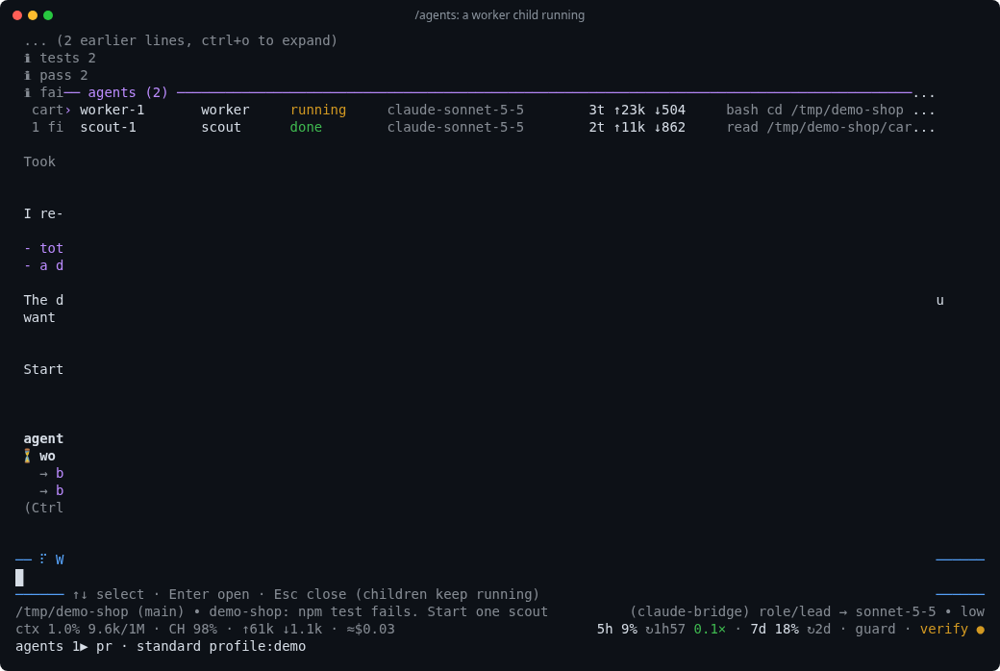
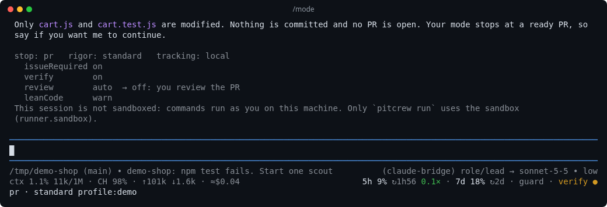
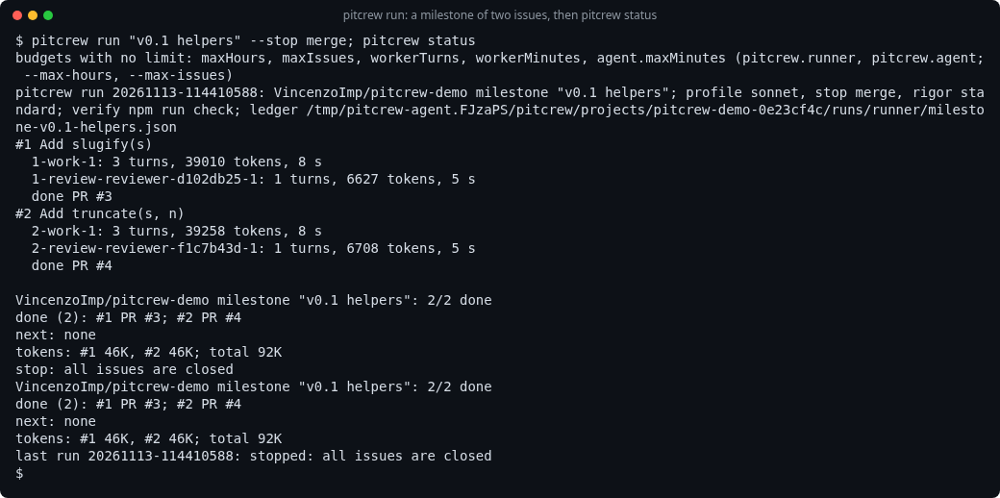

<p align="center">
  
</p>

<h1 align="center">pitcrew</h1>

<p align="center">
  A crew for the <a href="https://github.com/earendil-works/pi">pi coding agent</a>: roles instead of model names,
  child agents you can watch and steer, and guard rails from issue to merged pull request.
</p>

<p align="center">
  <a href="https://github.com/VincenzoImp/pitcrew/actions/workflows/ci.yml"></a>
  <a href="https://www.npmjs.com/package/@vincenzoimp/pitcrew"></a>
  <a href="LICENSE"></a>
  <a href="UPSTREAM.md"></a>
</p>

<p align="center">
  
</p>

## What you get

- **Roles, not model names.** You talk to `lead`; `worker`, `scout`, `reviewer` and `second` do
  the rest. A profile says which model and thinking level answers for each role, per session.
- **Child agents you can see.** The lead starts children in the background; `/agents` shows each
  one live, and you can steer it, answer it or stop it.
- **A mode per piece of work.** `stop` says how far the agent goes alone (a plan, local commits, a
  PR, a merge); `rigor` says which checks run.
- **Guard rails.** The guard blocks catastrophic commands and asks before risky ones; the verify
  gate means "done" only when the repo's own check passed on the current tree.
- **Unattended delivery.** `pitcrew run` takes the issues of a milestone one by one: worktree,
  fresh worker, checks, PR, review, merge or stop, cleanup. Run it again to continue.
- **Web tools, 14 skills, and a footer** with context use, cache, cost and subscription windows.

It is one pi package. It works with any provider pi supports: a subscription, an API key, or a
local server.

## Quick start

1. Install [pi](https://pi.dev) and log in to a provider (`/login` in pi).
2. Set up pitcrew in a terminal (it asks one or two questions):
   ```sh
   npx @vincenzoimp/pitcrew init
   ```
3. In a repo of yours, run `pi` and ask for something small: "the test for X fails, find out why and
   fix it".

`pitcrew init` checks Node and pi, registers the package, adds the baseline settings without
changing yours, proposes a profile that works with your logins, and lists the optional parts
(GitHub CLI, Exa search key, Claude bridge, Docker). Model calls are billed by your provider (your
plan, its credits, or API prices); the footer shows the cost and the plan windows. More:
[getting started](docs/getting-started.md).

## Concepts

| Concept | In one line |
| --- | --- |
| Role | a model slot: `lead` (you talk to it), `worker`, `scout`, `reviewer`, `second` |
| Profile | which model and thinking level answer for each role; examples for `claude-bridge`, `codex`, `anthropic`, `openai`, `google`, `local`; with none set, the first in this order whose models you can use |
| Session mode | `stop` (how far the agent goes alone) and `rigor` (which checks run), per session |
| Tracking | a repo setting: where plans and work items live (`none`, `local`, `github`) |
| Agent, child | an agent is a definition (`worker`, `scout`, `reviewer`, `researcher`); a child is one running instance |
| Skill | method for one kind of work; the model picks some, you start the others with `/skill:<name>` |
| Guard | blocks catastrophic commands, asks before risky ones, holds the delivery rules |
| Verify gate | "done" means the repo's own check passed on the current tree |
| Runner | `pitcrew run`: delivers the issues of a target unattended, resumable |
| Sandbox | the container `pitcrew run` uses for repos that are not yours |

Every word: [glossary](docs/glossary.md). Three diagrams: [how it works](docs/how-it-works.md).

<p align="center">
  
</p>

## Commands

| In a session | |
| --- | --- |
| `/profile`, `/role` | show or change the role map of this session |
| `/mode` | show or change `stop`, `rigor` and the switches |
| `/agents` (`alt+a`) | the panel of child agents |
| `/handoff [goal]` | go on in a fresh session with the same mode and roles |
| `/guard`, `/stats`, `/skill:<name>` | guard dialogs on or off; usage and cost; run a skill |

| In the shell | |
| --- | --- |
| `pitcrew init` | set up, or check a setup |
| `pitcrew run <milestone \| issue \| label:x>` | deliver GitHub issues unattended; `pitcrew status` for the digest |
| `pitcrew tidy` | remove the worktree and branches of merged work, with proof |
| `pitcrew check` | lean-code checks on a branch |
| `pitcrew box` | the sandbox container |

All of them, with flags and keys: [commands](docs/commands.md).

<p align="center">
  
</p>

## What it costs

Measured once each with pi 1.5.2, so read them as orders of size. Details and models:
[live tests](docs/TESTS.md).

| Thing | Cost |
| --- | --- |
| Standing context: global rules and model-picked skill descriptions | about 1,300 tokens in every request |
| First request of a session | about 4,700 tokens natively; about 7,700 through the Claude bridge |
| First request of a `scout` child | about 2,400 tokens natively; about 4,600 through the bridge |
| `web_search` | Exa: about $0.012 per search (free monthly credit), no model tokens; Codex: 8,700 to 13,200 tokens of the plan |
| `pitcrew run`, one small issue, `stop pr` | about 75,000 tokens, 47 s (local model) |
| `code-review` of a small risky change | about 180,000 tokens sent by the lead, plus 77,000 by its children |
| Sandbox start | 1.9 s |

## Limits

- **Sessions are not sandboxed.** Commands run as you, on this machine. The guard catches mistakes
  with pattern rules; it is not a security boundary. Only `pitcrew run` uses the container.
- **No fallback model.** If a role's model is missing or refuses for quota, the request fails with
  the reason; after the reset you resume (`pi --continue`, `/agents resume`, the same `pitcrew run`).
- **Small local models** overflow on large reads and research fan-out, and often do not load a
  skill by themselves: name it.
- **Claude through `pi-claude-bridge`** (optional) adds Claude Code's own prompt and drops some
  prompt channels; pitcrew uses only the channels that pass ([claude-access](docs/claude-access.md)).
- `pitcrew run` works one issue at a time, on GitHub only.

When something goes wrong: [troubleshooting](docs/troubleshooting.md).

## Docs

[Getting started](docs/getting-started.md) · [Install](docs/install.md) ·
[How it works](docs/how-it-works.md) · [Commands](docs/commands.md) · [All docs](docs/README.md)

## Contributing

Issues and pull requests are welcome: read [CONTRIBUTING](CONTRIBUTING.md) first. Security
problems: [SECURITY](SECURITY.md). Changes: [CHANGELOG](CHANGELOG.md).

## Licence

[MIT](LICENSE). Text and code from other projects keep their licences:
[THIRD_PARTY_NOTICES](THIRD_PARTY_NOTICES.md). Versions tested against: [UPSTREAM](UPSTREAM.md).
