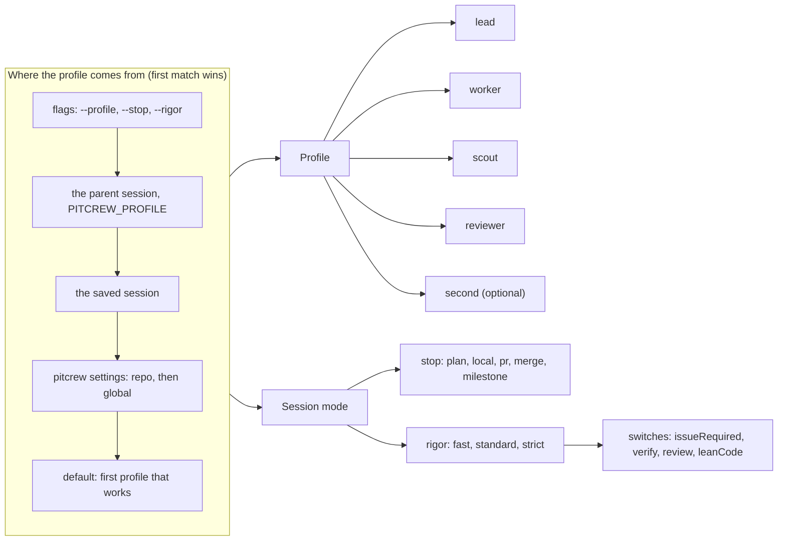
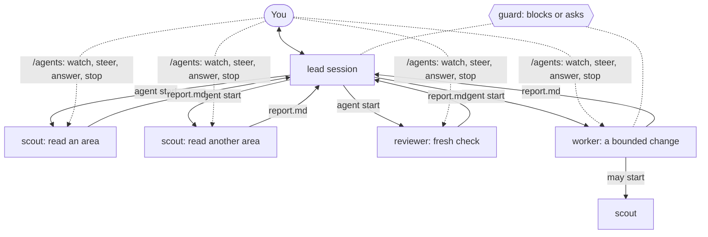
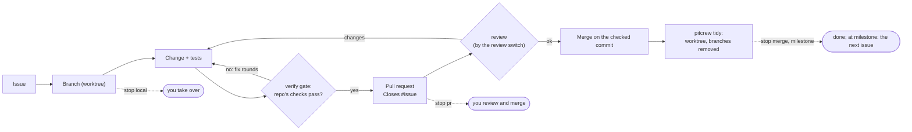

# How it works

Three pictures of pitcrew: what a session is made of, how the lead works with child agents, and
how a piece of work goes from an issue to a merged change.

## A session: profile, roles, mode

A session starts with a **profile** that gives each **role** a model and a thinking level. You
always talk to `lead`; children and summaries use the other roles. The **session mode** says how far
the agent goes alone (`stop`) and which checks run (`rigor`). Each session has its own; `/profile`,
`/role` and `/mode` change it for that session only.

The mode comes from the same places in a slightly different order: flags, then the saved session,
then the parent session, then the settings ([mode.md](mode.md)). Details: [roles.md](roles.md).

## The lead and its agents

The lead starts **children** with the `agent` tool: each is its own pi process with the guard, the
roles and the verify gate loaded, and it sees only its task. Children run in the background; their
reports come back as one message. You watch and steer them in `/agents`.

Details: [agent.md](agent.md), [guard.md](guard.md).

## Delivery: issue to merged change

One procedure for every piece of work. The `stop` dial says where the agent stops and hands over;
`rigor` says which checks run on the way. `pitcrew run` does the same loop unattended, one issue at
a time.

Details: [delivery.md](delivery.md), [runner.md](runner.md), [verify-gate.md](verify-gate.md).
