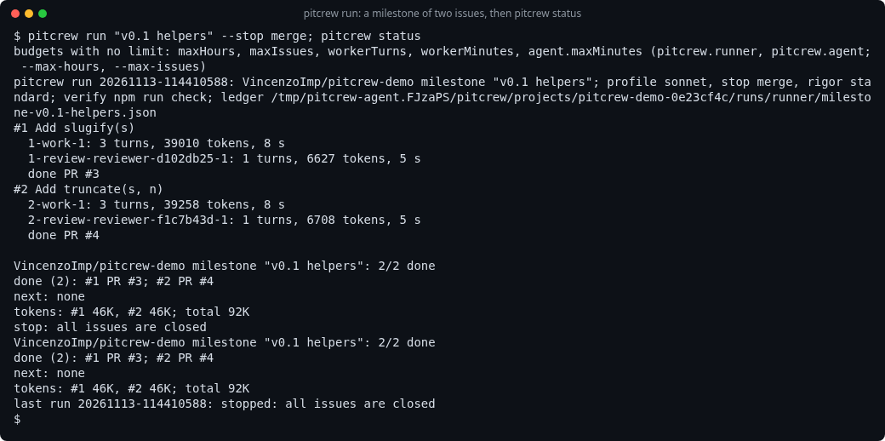

# Runner

Long unattended work that outlives sessions, context limits and quota resets: a deterministic loop
over the issues of a target. Code decides what runs next, runs every check and makes every GitHub
write. Models only build (a fresh `worker` per issue) and review (a fresh `reviewer`).
Code: `lib/run.ts` (the loop, GitHub, children), `lib/run-plan.ts` (pure logic), `bin/pitcrew`.

```
pitcrew run <target> [--stop pr|merge|milestone|local] [--rigor fast|standard|strict] [--<switch> <value>]
                    [--profile <name>] [--sandbox off|foreign|always] [--max-issues <n>] [--max-hours <h>] [--dry-run]
pitcrew status [<target>] [--post]
```



A real run in a scratch repo, every role on Sonnet at low thinking, `--stop merge`: two small
issues done in 68 seconds.

Target: a milestone title (`pitcrew run v0.3 runner`), a parent issue (`pitcrew run 12`: its
sub-issues, in their order), `label:<name>`, or a list of issues (`pitcrew run 14 15 18`). Run it
from any checkout of the repo. `--dry-run` prints the digest and the frontier and changes nothing.

## The loop

1. **Frontier** from GitHub: open issues of the target with no open blocker (dependencies) and no
   open sub-issue, not labelled `needs-owner`, not already handed over (a ready PR at stop `pr`).
   Work in progress comes first; then the target's order (number, sub-issue order, or the list).
   Computed again after each issue, so an issue starts once its blockers are merged.
2. **Per issue**, one worktree `../<repo>.wt/<issue>-<slug>` and branch `<issue>-<slug>` from
   `origin/<default branch>` (the `github` skill defaults). `pitcrew.runner.setup` runs in it first
   (for example `npm ci`).
3. **Worker**: a fresh headless `pi --mode rpc` child with the role `worker`, started with the
   same child code as the agent tool (`runChild` in `lib/rpc-child.ts`): every pitcrew extension loads, so the
   guard (strict: no user, asks are blocks), the roles and the verify gate run in it; `--no-approve`;
   the role map of `--profile`, else of the pi session the run was started from, else
   `PITCREW_PROFILE` or `pitcrew.profile` (the start line names the profile). Its prompt is
   `/skill:github` with the issue, at stop `local`: build, verify, commit on the branch.
   It never pushes, opens a PR, comments or merges; the guard's worker rules block that
   (`PITCREW_RUNNER_ROLE=worker`) and also a nested `pitcrew run`.
4. **Checks**, cheap first, on the committed tree: a clean worktree, at least one commit, the repo's
   verify command (found in the main checkout like the verify gate: `PI_VERIFY`, `verify` or `check`
   script, …, and the `test` script as a fallback, [verify-gate.md](verify-gate.md#which-command);
   the start line names the command and why; the worker is told not to change it), `pitcrew check` by the `leanCode` switch (`block`
   fails the check, `warn` goes into the PR body). Then push, a draft PR (`Closes #<issue>`), CI
   (`gh pr checks --watch --fail-fast`, when the repo has workflows), and a fresh `reviewer` by the
   `review` switch: `on`, or `auto` when the run merges by itself (`stop` `merge` or `milestone`);
   at `stop pr` the owner reviews the PR. At `strict`, when the profile has a `second` role, also one on it. The reviewer
   ends with a JSON verdict; no verdict twice blocks the issue.
5. A failed check starts a new worker with the failure, at most the fix rounds of the rigor
   (`fast` 1, else 2); then all checks run again.
6. **Stop dial**: `local` keeps the verified branch and worktree; `pr` marks the PR ready and moves
   on; `merge` and `milestone` merge with `--squash --match-head-commit <checked sha>`, wait until
   the issue is closed, then `pitcrew tidy <pr>`. In a repo that is not yours the run stops at `pr`
   and writes no labels or comments.
7. **End**: the frontier is empty (all closed, or only blocked or waiting work), or a budget is
   used. At `stop milestone`, when every issue of the milestone is closed, the run closes the
   milestone and cuts the next 0.x release if the repo already has 0.x releases.
   It prints the digest; with tracking `github` and one Project linked to the repo it also posts it
   as a Project status update.

## Idempotence and limits

| Rule | How |
| --- | --- |
| Stable request id for every GitHub write | a PR is looked up by its branch first (open: reused; merged: done); a merge checks the PR state first; a comment carries a hidden marker `<!-- pitcrew-run:<id> -->` and is skipped when the marker is there; a label is idempotent; the milestone's release is cut once (the ledger records it, and its notes carry a marker for a rerun from another checkout) |
| Restart limit per issue | each worker start of the first build counts; a run killed during it counts too. Above `maxRestarts` + 1 the issue is blocked |
| Turn and time limit per worker | at 80 % of `workerTurns` the worker is asked to finish and report; at 100 % it is stopped. `workerMinutes` per worker (the reviewer: `pitcrew.agent.maxMinutes`, 0 by default), both capped by the run's wall clock. 0 = no limit |
| Stated policy after a failed issue | label `needs-owner`, one comment (`Blocked: … Tried: … Next: …` with the output tail), the worktree removed (commits stay on the local branch, a PR stays open), and the run goes on with issues that do not depend on it |

A blocked issue comes back when the owner removes the label: the next run starts it fresh.

## Budgets

`pitcrew.runner` in the global or the repo's settings (the repo wins), or flags. A repo that is not
yours (no admin permission, the guard's test) gets no say: the run ignores its `.pi/settings.json`
and `.pi/profiles`, so it cannot turn protections off or set `runner.setup`, a command that runs on
this host. The start of the run says so. The same holds for `workDir`: the repo's wins in your own
repos; `pitcrew status` reads the ledger from the same place. 0 = no limit, and
it is the default for the four budgets: real work cannot be estimated, a
run that stops on its own budget in the middle of a milestone helps nobody, and a run resumes anyway.
`maxRestarts` keeps a bound (without it a failing issue is retried forever), and so do the worktree
and disk caps.

| Key | Default | Meaning |
| --- | --- | --- |
| `maxHours` (`--max-hours`) | 0 | wall clock of one run; every worker, check and CI wait is capped by it. 0 = no limit |
| `maxIssues` (`--max-issues`) | 0 | issues one run takes on. 0 = no limit |
| `maxRestarts` | 2 | worker restarts per issue after a kill or a crash |
| `workerTurns`, `workerMinutes` | 0, 0 | per worker (turns also per reviewer). 0 = no limit |
| `setup` | none | command for a new worktree |
| `sandbox` (`--sandbox`) | `foreign` | workers and the verify command in the sandbox: `foreign` (repos that are not yours), `always`, `off` |

Fixed caps, not settings: the verify command 30 minutes, `setup` 20 minutes, one CI wait
45 minutes (each also within `maxHours`); the reviewer sees the diff up to 120,000 characters and
the issue body up to 10,000 (the worker 20,000). Also: the worktree and disk caps of the guard
(`pitcrew.caps`): no new worktree above them. One run per repo at a time (a lock file).

## Notification

On a terminal, `pitcrew run` reports its state with pi's status protocol (OSC 7501, read by terminals
and agent dashboards): `working` at the start, then `done`, `blocked` (issues wait for the owner) or
`error`. `pitcrew.notify: false` in the global settings, or `PI_PROGRAM_STATUS=0`, turns it off.

## When the quota runs out

The runner does not check quota before a child. When a provider refuses a worker or reviewer request
for quota, the run stops: `stop: provider quota used up (<the provider's error>); nothing is lost:
run the same command again after the reset`. The issue is not blocked, gets no label or comment, and
the refused start does not count as a worker start or a fix round. The worktree, its commits, an
open PR and the ledger stay. Run the same `pitcrew run …` after the reset: it goes on from the
issue's phase.

## Resume

Run the same command again. State is GitHub plus the runner's ledger
`<work folder>/runs/runner/<target key>.json` (per issue: phase, attempts, fix rounds, branch, worktree,
PR, reason, tokens, turns, time; per run: start, end, stop reason). An issue killed during its
worker gets a new worker on the same worktree (its commits are kept); one killed after its commits
goes straight to the checks and reuses its PR. Children die with the runner (they read their
stdin); nothing is left running.

## Sandbox

`pitcrew.runner.sandbox` (default `foreign`): in a repo that is not yours the workers and the verify
command run in the sandbox ([sandbox.md](sandbox.md)); `always` for every repo; `--sandbox <value>`
for one run. The sandbox needs the image (`pitcrew box build`); without it the run stops at the start
and says so. The run asks nothing anyway: workers have no user and the guard is strict.

## `pitcrew status`

```
owner/repo milestone "runner live": 2/3 done
done (2): #18 PR #21; #19 PR #22
blocked (1): #20: verify failed after 1 fix round(s)
next: none
last run 20261112-…: stopped: only blocked or waiting work is left
```

No target: the target of the last run in this repo. A last line gives the tokens of each issue (all
its workers and reviewers, from the ledger) and their total. `pitcrew run` prints the same line at its
end, and at its start the budgets that have no limit. `--post` posts the digest as a Project status
update (`AT_RISK` with blocked work, `COMPLETE` when all is done, else `ON_TRACK`), unless the last
update says the same.

## Limits

- One issue at a time.
- The frontier of a milestone or a label comes from `gh issue list`, which uses GitHub search: an
  issue created seconds before the run can be missing from it until the next run.
- The verify command comes from the main checkout, but a worker can still edit the tests it runs;
  the reviewer checks for weakened tests.
